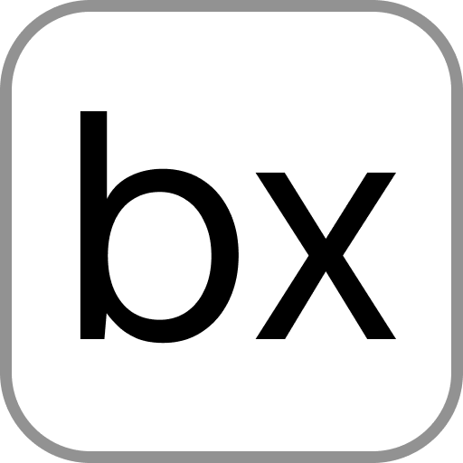
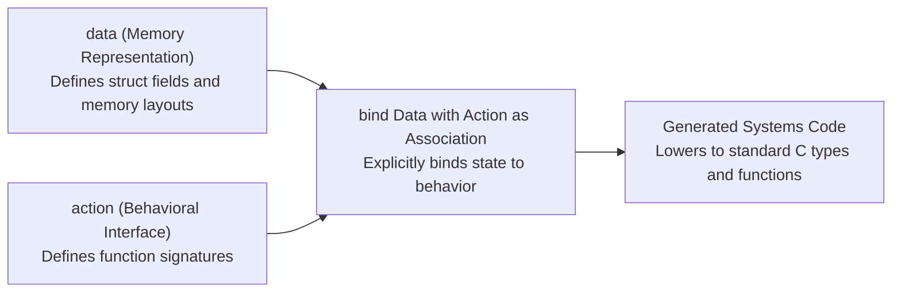
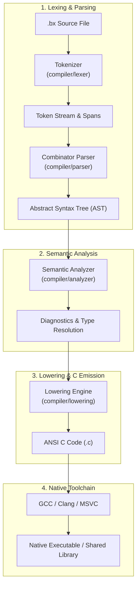

<p align="center">
  <a href="https://bliss-compiler.vercel.app/" target="_blank">
    
  </a>
</p>

<h1 align="center">The Bliss Programming Language</h1>

<p align="center">
  <strong>An experimental systems programming language exploring Data-Action Oriented Programming (DAOP), explicit memory semantics, and direct lowering to standard C.</strong>
</p>

<p align="center">
  <a href="https://github.com/MayukhChakrabortyDX/bliss-compiler/releases"></a>
  <a href="https://github.com/MayukhChakrabortyDX/bliss-compiler/actions/workflows/ci.yml"></a>
  <a href="https://bun.sh/"></a>
  <a href="https://en.wikipedia.org/wiki/C99"></a>
  <a href="#"></a>
  <a href="LICENSE"></a>
</p>

<p align="center">
  <a href="https://bliss-compiler.vercel.app/">Website</a> &bull;
  <a href="#overview">Overview</a> &bull;
  <a href="#data-action-oriented-programming-daop">DAOP Paradigm</a> &bull;
  <a href="#syntax-and-examples">Syntax & Examples</a> &bull;
  <a href="#getting-started">Getting Started</a> &bull;
  <a href="#cli-usage">CLI Usage</a> &bull;
  <a href="#compiler-architecture">Architecture</a> &bull;
  <a href="#project-status-and-roadmap">Roadmap</a> &bull;
  <a href="CONTRIBUTING.md">Contributing</a>
</p>

---

## Overview

Bliss is an experimental systems programming language designed from first principles. Rather than bundling state, interfaces, and methods into monolithic class hierarchies or relying entirely on unconstrained procedural idioms, Bliss investigates **Data-Action Oriented Programming (DAOP)**.

In DAOP, physical memory layouts (`data`), interface specifications (`action`), and concrete associations (`bind`) remain cleanly decoupled. Bliss code compiles directly to portable ANSI C (C99/C11), offering transparent low-level control, predictable memory representation, and direct interoperability with existing C toolchains.

### Core Design Goals

- **Structural Decoupling**: Separation of memory representation (`data`) from behavioral contracts (`action`).
- **Explicit Semantics**: Systems operations and memory modifiers (`let (unsafe)`, `let (trans)`, `let (const)`) make intent visible without hidden compiler transformations.
- **Custom Allocator Model**: First-class language constructs for custom memory allocators (`allocator`, `new`, `free`).
- **Standard C Lowering**: Emits standard C, allowing programs to leverage existing C optimizers (GCC, Clang, MSVC), debuggers, and system ABIs.
- **Standalone Binary Distribution**: The compiler compiles into a zero-dependency native executable for Linux, Windows, and macOS.

---

## Data-Action Oriented Programming (DAOP)

Traditional object-oriented languages tightly couple physical state and behavioral dispatch inside classes, frequently introducing runtime costs such as vtables, object layout restrictions, and rigid inheritance trees.

Bliss separates these concerns into three distinct declarations:



1. **`data`**: Declares concrete memory layouts (records, primitives, pointers, and array buffers).
2. **`action`**: Declares behavioral capabilities (function signatures).
3. **`bind`**: Explicitly binds a data type to an action contract under a named association.

---

## Syntax and Examples

### 1. Data, Action, and Binding

```bliss
// Define the memory layout
data Vector2D {
    data x: i32;
    data y: i32;
}

// Define the interface contract
action Scalable {
    fx scale(data factor: i32): void;
}

// Explicitly bind the data type to the action
bind Vector2D with Scalable as VectorMath {
    fx scale(data factor: i32): void {
        x = x * factor;
        y = y * factor;
    }
}
```

### 2. Explicit Systems Modifiers

For low-level memory interactions, Bliss requires explicit qualifiers at declaration sites:

```bliss
data Node {
    data val: i32;
    data next: [Node];
}

fx createNode(data val: i32): [Node] {
    let (unsafe) node: [Node] = malloc(sizeof Node);
    node.val = val;
    node.next = node;
    return node;
}
```

### 3. Custom Memory Allocator Grammar

```bliss
allocator Arena {
    fx allocate(data size: u64): [u8];
    fx reset(): void;
}
```

### 4. Generated C Output

Bliss lowers top-level declarations directly into ANSI C (C99/C11):

<table>
<tr>
<th>Bliss Source (<code>point.bx</code>)</th>
<th>Generated C (<code>point.c</code>)</th>
</tr>
<tr>
<td>

```bliss
data Point {
    data x: i32;
    data y: i32;
}

fx render(data p: i32) {
}
```

</td>
<td>

```c
#include <stdint.h>

typedef struct {
    int32_t x;
    int32_t y;
} Point;

void render(int32_t p) {}
```

</td>
</tr>
</table>

---

## Getting Started

### Pre-compiled Standalone Binaries

Self-contained binaries are built for every release and available on the [GitHub Releases](https://github.com/MayukhChakrabortyDX/bliss-compiler/releases) page:

| Operating System | Target Architecture | Binary Name |
| :--- | :--- | :--- |
| **Linux** | x86_64, ARM64 | `bliss-linux-x64`, `bliss-linux-arm64` |
| **Windows** | x86_64, ARM64 | `bliss-windows-x64.exe`, `bliss-windows-arm64.exe` |
| **macOS** | Apple Silicon (ARM64) | `bliss-macos-arm64` |

On Unix systems, grant execution permission after downloading:

```bash
chmod +x bliss-linux-x64
mv bliss-linux-x64 /usr/local/bin/bliss
```

### Building From Source

The compiler is developed in TypeScript and runs on [Bun](https://bun.sh/).

```bash
# Clone the repository
git clone https://github.com/MayukhChakrabortyDX/bliss-compiler.git
cd bliss-compiler

# Install development dependencies
bun install

# Compile the standalone native binary
bun run build:alpha

# The output executable is placed at dist/builds/bliss (or bliss.exe on Windows)
```

---

## CLI Usage

The Bliss CLI driver supports single-file compilation, automated output path resolution, and batch processing:

```bash
# Compile a single file to C (creates input.c alongside input.bx)
bliss input.bx

# Compile a file with explicit output destination
bliss input.bx -o build/output.c

# Bulk-compile all .bx files within a directory
bliss tests --bulk -o build/tests
```

### Command Flags

| Flag | Argument | Description |
| :--- | :--- | :--- |
| `-o, --output` | `<path>` | Specify destination `.c` file or output folder (when using `--bulk`) |
| `-b, --bulk` | _none_ | Recursively compile all `.bx` source files in the input path |
| `-h, --help` | _none_ | Display usage information and compiler version |

### Diagnostic Output

The compiler uses source-span tracking to produce clear terminal diagnostics when syntax or semantic errors occur:

```text
error: Expected the keyword data
  ╭─▶ line 2, column 5
  │
1 │ data Node {
2 │     i32 val;
  │     ^^^ Got keyword i32
3 │     [Node] next;
  │
  ╰─ help: In Bliss, declare fields using 'data <name>: <type>;'
```

---

## Compiler Architecture

The compiler is structured as a pipeline of distinct phases:



- **`compiler/lexer/`**: Tokenizer with precise source span tracking, keyword matching, and string scanning.
- **`compiler/parser/`**: Production combinator parser implementing grammar rules for DAOP, functions, loops, and types.
- **`compiler/analyzer/`**: Symbol table validation, diagnostic reporting, and type verification.
- **`compiler/lowering/`**: Maps Bliss AST structures into portable ANSI C code.
- **`builds/`**: CLI runtime entry point with diagnostic formatting and batch compilation routines.

---

## Test Suite

The repository includes a suite of 350+ `.bx` programs under `tests/` validating language constructs, edge cases, and parser stability:

```bash
# Run the test suite against the compiler
bun run test

# Compile an individual test file
bun run compile tests/daop_018_bind_single_action.bx
```

---

## Project Status and Roadmap

Bliss is currently in active pre-alpha development. The current focus is completing expression-level lowering and control flow emission to C.

- [x] Tokenizer with source span tracking and comment handling
- [x] Combinator-based recursive descent parser
- [x] Grammar specifications for DAOP (`data`, `action`, `bind`)
- [x] Source-referenced diagnostic rendering
- [x] ANSI C code generation for top-level data structures and function signatures
- [x] Cross-platform build automation via GitHub Actions (Linux, Windows, macOS)
- [ ] Statement and expression lowering (`loop`, `if`, arithmetic, assignments)
- [ ] Static method call resolution for bindings
- [ ] Allocator runtime implementation and lowering
- [ ] Initial standard library modules (`std.io`, `std.mem`)
- [ ] Syntax highlighting definitions for text editors

---

## Contributing

Contributions, bug reports, and design discussions are welcome. Please refer to:

- **[CONTRIBUTING.md](CONTRIBUTING.md)**: Architecture guide, local development workflow, and coding conventions.
- **[CODE_OF_CONDUCT.md](CODE_OF_CONDUCT.md)**: Community standards and participation guidelines.
- **[SECURITY.md](SECURITY.md)**: Vulnerability reporting guidelines.

---

## License

Bliss is open-source software licensed under the [MIT License](LICENSE).  
Copyright &copy; 2026 **Mayukh Chakraborty**.
